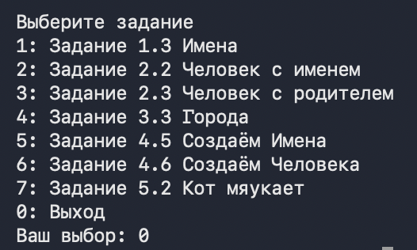
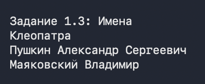
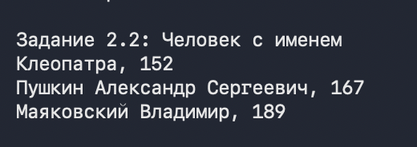
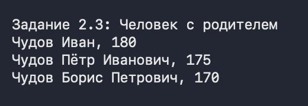
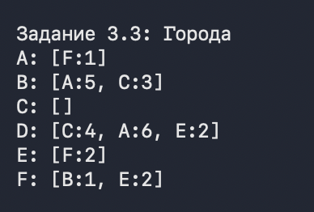
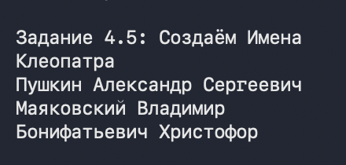
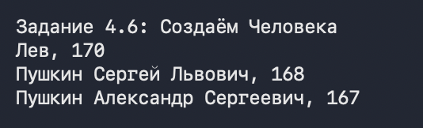
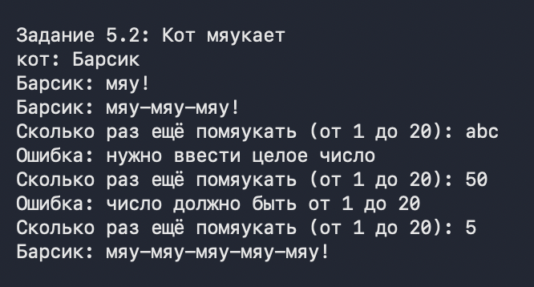

# Лабораторная работа №3. Объектно-ориентированное программирование

Программа на C++ (вариант 3) с меню заданий 1.3, 2.2, 2.3, 3.3, 4.5, 4.6 и 5.2. Полный отчёт со скриншотами приведён ниже в разделе «Отчёт», скриншоты лежат в папке `Screens/`.

Файлы проекта: `Name.h`, `Name.cpp`, `Person.h`, `Person.cpp`, `City.h`, `City.cpp`, `Cat.h`, `Cat.cpp`, `Input.h`, `Input.cpp`, `main.cpp`.

## Сборка и запуск

```
g++ -std=c++17 *.cpp -o lab3
./lab3
```

## Особенности реализации

- Каждый класс разделён на заголовочный файл (объявление с Doxygen-документацией) и файл реализации. Классы лежат в пространстве имён `lab3`.
- Требуемая в условии функция `print()` реализована как `Print()`: так названы функции по Google C++ Style Guide.
- Каждое задание, которое «изменяет» предыдущую сущность (4.5 меняет 1.3, 4.6 меняет 2.3), реализовано в одном и том же классе, поэтому в коде хранится итоговая версия.
- Ввод с клавиатуры (выбор пункта меню и число мяуканий) проверяется функциями из `Input.h` (пространство имён `input`): при некорректном вводе запрос повторяется.

## Отчёт

**Денисов Кирилл Лабораторная №3**

### Меню программы

При запуске программа выводит меню заданий. Пункт выбирается числом от 0 до 7, ввод проверяется функцией `ReadIntInRange`: при некорректном вводе запрос повторяется. Пункт 0 завершает программу.



*Рисунок 0 – Меню программы*

### Задание 1

#### Задача 3

##### Текст задачи

Создайте сущность Имя, которая описывается тремя параметрами: Фамилия, Личное имя, Отчество. Имя может быть приведено к строковому виду, включающему традиционное представление всех трех параметров: Фамилия Имя Отчество (например «Иванов Иван Иванович»). Необходимо предусмотреть возможность того, что какой-либо из параметров может быть не задан, и в этом случае он не учитывается при приведении к текстовому виду.

Необходимо создать следующие имена: Клеопатра; Пушкин Александр Сергеевич; Маяковский Владимир. Обратите внимание, что при выводе на экран не заданные параметры никак не участвуют в образовании строки.

Общее требование к заданию: Решение всех задач оформить в одном проекте, но в разных классах. В каждом классе должны присутствовать свойства, конструкторы и функция print().

##### Алгоритм решения

1. Класс `Name` хранит три строки: `first_name_` (личное имя), `last_name_` (фамилия) и `patronymic_` (отчество). Не заданная часть – пустая строка.

2. Конструкторы: только личное имя; личное имя и фамилия; личное имя, отчество и фамилия (последние два введены задачей 4.5, класс общий для задач 1.3 и 4.5). Конструктор от одной строки помечен `explicit`, чтобы строка не превращалась в `Name` неявно.

3. `ToString` складывает фамилию, имя и отчество в массив в порядке «Фамилия Имя Отчество» и в цикле пропускает пустые части. Пробел ставится только перед частью, если в результате уже что-то есть, поэтому лишних пробелов нет ни в начале, ни между частями.

4. `Print` выводит результат `ToString` на экран.

**Листинг 1 – Класс Name и создание имён**

```cpp
// Name.h (поля класса)
private:
    std::string first_name_;
    std::string last_name_;
    std::string patronymic_;

// Name.cpp
Name::Name(const std::string& first_name)
        : first_name_(first_name) {}

Name::Name(const std::string& first_name, const std::string& last_name)
        : first_name_(first_name), last_name_(last_name) {}

// Порядок параметров совпадает с привычной записью Имя Отчество Фамилия
Name::Name(const std::string& first_name, const std::string& patronymic,
        const std::string& last_name)
        : first_name_(first_name),
          last_name_(last_name),
          patronymic_(patronymic) {}

void Name::set_last_name(const std::string& last_name) {
    last_name_ = last_name;
}

void Name::set_patronymic(const std::string& patronymic) {
    patronymic_ = patronymic;
}

// Собирает строку Фамилия Имя Отчество, пустые части пропускаются
std::string Name::ToString() const {
    const std::string parts[] = {last_name_, first_name_, patronymic_};
    std::string result = "";
    for (const std::string& part : parts) {
        if (part.empty()) {
            continue;
        }
        if (!result.empty()) {
            result += ' ';
        }
        result += part;
    }
    return result;
}

void Name::Print() const {
    std::cout << ToString() << "\n";
}

// main.cpp
// Задание 1.3: имена с незаданными частями
void Task1() {
    PrintTitle("Задание 1.3: Имена");
    const lab3::Name cleopatra("Клеопатра");
    const lab3::Name pushkin("Александр", "Сергеевич", "Пушкин");
    const lab3::Name mayakovsky("Владимир", "Маяковский");
    cleopatra.Print();
    pushkin.Print();
    mayakovsky.Print();
}
```

##### Тестирование



*Рисунок 1 – Задание 1, задача 3: работа программы*

*Таблица 1 – Результаты автотестов, задание 1*

| **Входные данные** | **Ожидается** | **Получено** | **Итог** |
|---|---|---|---|
| `Name("Клеопатра")` | `Клеопатра` | `Клеопатра` | пройден |
| `Name("Александр", "Сергеевич", "Пушкин")` | `Пушкин Александр Сергеевич` | `Пушкин Александр Сергеевич` | пройден |
| `Name("Владимир", "Маяковский")` | `Маяковский Владимир` | `Маяковский Владимир` | пройден |
| `Name()` (ничего не задано) | `[]` | `[]` | пройден |

### Задание 2

#### Задача 2

##### Текст задачи

Объедините сущности Человек из задачи 1.2 и Имя из задачи 1.3 таким образом, чтобы имя человека задавалось с использованием сущности 1.3, а не строки.

Необходимо объединить ранее созданные объекты имён и людей, с получением: Человека с Именем Клеопатра и ростом 152; Человека с Именем Пушкин Александр Сергеевич и ростом 167; Человека с Именем Маяковский Владимир и ростом 189.

##### Алгоритм решения

1. Класс `Person` хранит имя в поле `name_` типа `Name` (а не строкой) и рост в поле `height_`.

2. Создаются три человека: каждому передаётся готовый объект `Name` и рост.

3. Строковая форма человека – «Имя, рост» (формат введён задачей 4.6, класс общий для всех задач с человеком): `ToString` берёт строку имени у объекта `Name` и дописывает через запятую рост.

**Листинг 2 – Поля класса Person и создание людей**

```cpp
// Person.h (поля класса)
private:
    Name name_;
    int height_ = 0;
    const Person* father_ = nullptr;

// main.cpp
// Задание 2.2: имя человека задаётся объектом Name, а не строкой
void Task2() {
    PrintTitle("Задание 2.2: Человек с именем");
    const lab3::Person cleopatra(lab3::Name("Клеопатра"), 152);
    const lab3::Person pushkin(
            lab3::Name("Александр", "Сергеевич", "Пушкин"), 167);
    const lab3::Person mayakovsky(lab3::Name("Владимир", "Маяковский"), 189);
    cleopatra.Print();
    pushkin.Print();
    mayakovsky.Print();
}
```

##### Тестирование



*Рисунок 2 – Задание 2, задача 2: работа программы*

*Таблица 2 – Результаты автотестов, задание 2 (задача 2)*

| **Входные данные** | **Ожидается** | **Получено** | **Итог** |
|---|---|---|---|
| `Person(Name("Клеопатра"), 152)` | `Клеопатра, 152` | `Клеопатра, 152` | пройден |
| `Person(Name("Александр", "Сергеевич", "Пушкин"), 167)` | `Пушкин Александр Сергеевич, 167` | `Пушкин Александр Сергеевич, 167` | пройден |
| `Person(Name("Владимир", "Маяковский"), 189)` | `Маяковский Владимир, 189` | `Маяковский Владимир, 189` | пройден |

#### Задача 3

##### Текст задачи

Измените сущность Человек из задачи 2.2, добавив ему возможность задавать третий параметр: Отец, где Отец – это тоже Человек. При приведении человека к строковой форме необходимо проверить параметры имени, и в зависимости от ситуации выполнить одно из следующих действий:

- Если у данного человека нет фамилии, и есть отец, у которого фамилия задана, то фамилию необходимо сделать такой же как у отца.
- Если у данного человека нет отчества, а у отца есть имя, то необходимо задать отчество как имя отца с добавлением суффикса «ович».

Затем необходимо выполнить следующие задачи: создать людей Чудова Ивана, Чудова Петра, Бориса; сделать Ивана отцом Петра, а Петра отцом Бориса; вывести на экран строковое представление всех троих людей.

##### Алгоритм решения

1. В класс `Person` добавлен указатель на отца `father_` (`const Person*`) и метод `set_father`, который назначает отца уже созданному человеку.

2. Метод `FullName` возвращает полное имя с учётом отца. Он копирует собственное имя человека и, если отец задан, запрашивает полное имя отца. Запрос рекурсивный, поэтому цепочка Иван – Пётр – Борис работает: Борис получает фамилию от Петра, а Пётр получил её от Ивана.

3. Если у человека нет фамилии, берётся фамилия отца. Если нет отчества, а у отца есть имя, отчество строится функцией `MakePatronymic`.

4. `MakePatronymic` строит отчество из имени отца: к имени добавляется «ович» (Иван – Иванович); имена на «й» получают «евич» (Сергей – Сергеевич); «ё» заменяется на «е» (Пётр – Петрович); имя «Лев» – исключение, отчество «Львович». Пол человека не учитывается (отчества только мужские).

5. Полное имя вычисляется при каждом выводе, а не при создании. Поэтому отец, назначенный позже через `set_father`, тоже учитывается.

6. В условии не указан рост Ивана, Петра и Бориса, в программе взяты значения 180, 175 и 170. Отцов нельзя замыкать в цикл (A – отец B, а B – отец A): `FullName` в этом случае уйдёт в бесконечную рекурсию.

**Листинг 3 – Отчество, полное имя и создание людей с отцами**

```cpp
// Person.cpp (вспомогательные функции)
// Сравнение побайтовое, поэтому подходит и для строк в UTF-8
bool EndsWith(const std::string& text, const std::string& suffix) {
    if (text.size() < suffix.size()) {
        return false;
    }
    return text.compare(text.size() - suffix.size(), suffix.size(),
            suffix) == 0;
}

// Заменяет все вхождения from на to
void ReplaceAll(std::string& text, const std::string& from,
        const std::string& to) {
    std::string::size_type pos = 0;
    while ((pos = text.find(from, pos)) != std::string::npos) {
        text.replace(pos, from.size(), to);
        pos += to.size();
    }
}

// Строит отчество из имени отца
// Иван - Иванович, Сергей - Сергеевич, Пётр - Петрович, Лев - Львович
std::string MakePatronymic(const std::string& father_name) {
    if (father_name == "Лев") {
        return "Львович";
    }
    std::string base = father_name;
    ReplaceAll(base, "ё", "е");
    if (EndsWith(base, "й")) {
        base.erase(base.size() - 2);
        return base + "евич";
    }
    return base + "ович";
}

// Person.cpp (методы)
void Person::set_father(const Person* father) {
    father_ = father;
}

// Полное имя вычисляется при каждом обращении, поэтому отец, заданный после
// создания объекта, тоже учитывается
Name Person::FullName() const {
    Name result = name_;
    if (father_ == nullptr) {
        return result;
    }
    const Name father_name = father_->FullName();
    if (result.last_name().empty()) {
        result.set_last_name(father_name.last_name());
    }
    if (result.patronymic().empty() && !father_name.first_name().empty()) {
        result.set_patronymic(MakePatronymic(father_name.first_name()));
    }
    return result;
}

std::string Person::ToString() const {
    return FullName().ToString() + ", " + std::to_string(height_);
}

void Person::Print() const {
    std::cout << ToString() << "\n";
}

// main.cpp
// Задание 2.3: отец задаётся после создания людей.
// Рост в условии не указан, значения выбраны произвольно
void Task3() {
    PrintTitle("Задание 2.3: Человек с родителем");
    lab3::Person ivan(lab3::Name("Иван", "Чудов"), 180);
    lab3::Person petr(lab3::Name("Пётр", "Чудов"), 175);
    lab3::Person boris(lab3::Name("Борис"), 170);
    petr.set_father(&ivan);
    boris.set_father(&petr);
    ivan.Print();
    petr.Print();
    boris.Print();
}
```

##### Тестирование



*Рисунок 3 – Задание 2, задача 3: работа программы*

*Таблица 3 – Результаты автотестов, задание 2 (задача 3)*

| **Входные данные** | **Ожидается** | **Получено** | **Итог** |
|---|---|---|---|
| Пётр Чудов до `set_father` | `Чудов Пётр, 175` | `Чудов Пётр, 175` | пройден |
| Борис до `set_father` | `Борис, 170` | `Борис, 170` | пройден |
| Иван Чудов (отца нет) | `Чудов Иван, 180` | `Чудов Иван, 180` | пройден |
| Пётр Чудов, отец Иван | `Чудов Пётр Иванович, 175` | `Чудов Пётр Иванович, 175` | пройден |
| Борис, отец Пётр | `Чудов Борис Петрович, 170` | `Чудов Борис Петрович, 170` | пройден |
| отчество, отец «Иван» | `Иванович` | `Иванович` | пройден |
| отчество, отец «Сергей» | `Сергеевич` | `Сергеевич` | пройден |
| отчество, отец «Лев» | `Львович` | `Львович` | пройден |
| отчество, отец «Пётр» | `Петрович` | `Петрович` | пройден |

### Задание 3

#### Задача 3

##### Текст задачи

Создайте сущность Город, которая будет представлять собой точку на карте со следующими характеристиками: название города; набор путей к следующим городам, где путь представляет собой сочетание Города и стоимости поездки в него. Кроме того, Город может возвращать текстовое представление в виде названия города и списка связанных с ним городов (в виде пары «название:стоимость»). Используя разработанную сущность, реализуйте схему, представленную на рисунке 2 условия.

##### Алгоритм решения

1. Класс `City` хранит название `name_` и вектор путей `paths_`. Путь – структура `City::Path` из двух полей: указатель на город назначения `destination` и стоимость поездки `cost`.

2. Город создаётся только с названием. Пути добавляются методом `AddPath(город, стоимость)`. Собрать граф одним конструктором нельзя: в нём есть циклы (A – F – B – A), и город назначения должен существовать до добавления пути к нему.

3. Города хранятся в программе по значению, а пути ссылаются на них по указателю. Поэтому копирование города запрещено (`= delete`): копия не была бы тем городом, на который указывают другие.

4. `ToString` выводит название, затем в квадратных скобках пары «название:стоимость» через запятую: `B: [A:5, C:3]`. У города без путей получается `C: []`.

5. Рёбра графа с рисунка 2, реализованные в программе: A → F (1), B → A (5), B → C (3), D → C (4), D → A (6), D → E (2), F → B (1), а ребро между F и E двустороннее: F → E (2) и E → F (2).

**Листинг 4 – Класс City и граф городов**

```cpp
// City.h (поля класса)
private:
    std::string name_;
    std::vector<Path> paths_;

// City.cpp
City::City(const std::string& name)
        : name_(name) {}

void City::AddPath(const City* destination, int cost) {
    paths_.push_back({destination, cost});
}

// Связанные города выводятся парами "название:стоимость" через запятую
std::string City::ToString() const {
    std::string result = name_ + ": [";
    for (size_t i = 0; i < paths_.size(); ++i) {
        if (i > 0) {
            result += ", ";
        }
        result += paths_[i].destination->name() + ":" +
                std::to_string(paths_[i].cost);
    }
    return result + "]";
}

void City::Print() const {
    std::cout << ToString() << "\n";
}

// main.cpp
// Задание 3.3: граф городов с рисунка 2
void Task4() {
    PrintTitle("Задание 3.3: Города");
    lab3::City a("A");
    lab3::City b("B");
    lab3::City c("C");
    lab3::City d("D");
    lab3::City e("E");
    lab3::City f("F");
    a.AddPath(&f, 1);
    b.AddPath(&a, 5);
    b.AddPath(&c, 3);
    d.AddPath(&c, 4);
    d.AddPath(&a, 6);
    d.AddPath(&e, 2);
    e.AddPath(&f, 2);
    f.AddPath(&b, 1);
    f.AddPath(&e, 2);
    a.Print();
    b.Print();
    c.Print();
    d.Print();
    e.Print();
    f.Print();
}
```

##### Тестирование



*Рисунок 4 – Задание 3, задача 3: работа программы*

*Таблица 4 – Результаты автотестов, задание 3*

| **Входные данные** | **Ожидается** | **Получено** | **Итог** |
|---|---|---|---|
| город A | `A: [F:1]` | `A: [F:1]` | пройден |
| город B | `B: [A:5, C:3]` | `B: [A:5, C:3]` | пройден |
| город C (путей нет) | `C: []` | `C: []` | пройден |
| город D | `D: [C:4, A:6, E:2]` | `D: [C:4, A:6, E:2]` | пройден |
| город E | `E: [F:2]` | `E: [F:2]` | пройден |
| город F | `F: [B:1, E:2]` | `F: [B:1, E:2]` | пройден |

### Задание 4

#### Задача 5

##### Текст задачи

Измените сущность Имя из задачи 1.3. Новые требования включают: имя можно создать, указав только личное имя; имя можно создать, указав личное имя и фамилию; имя можно создать, указав все три параметра: личное имя, фамилию, отчество.

Необходимо создать следующие имена: Клеопатра; Александр Сергеевич Пушкин; Владимир Маяковский; Христофор Бонифатьевич (здесь Христофор – это имя, а Бонифатьевич – фамилия).

##### Алгоритм решения

1. В классе `Name` три конструктора: `Name(имя)`, `Name(имя, фамилия)` и `Name(имя, отчество, фамилия)`. Порядок аргументов в последнем совпадает с привычной записью «Александр Сергеевич Пушкин».

2. Незаданные части остаются пустыми строками и не попадают в результат `ToString` (описано в задаче 1.3).

3. Для «Христофор Бонифатьевич» используется конструктор «имя, фамилия»: Христофор – имя, Бонифатьевич – фамилия. Строка выводится в порядке «Фамилия Имя Отчество», поэтому на экране получается «Бонифатьевич Христофор».

**Листинг 5 – Создание имён**

```cpp
// main.cpp
// Задание 4.5: три способа создать имя
void Task5() {
    PrintTitle("Задание 4.5: Создаём Имена");
    const lab3::Name cleopatra("Клеопатра");
    const lab3::Name pushkin("Александр", "Сергеевич", "Пушкин");
    const lab3::Name mayakovsky("Владимир", "Маяковский");
    const lab3::Name khristofor("Христофор", "Бонифатьевич");
    cleopatra.Print();
    pushkin.Print();
    mayakovsky.Print();
    khristofor.Print();
}
```

##### Тестирование



*Рисунок 5 – Задание 4, задача 5: работа программы*

*Таблица 5 – Результаты автотестов, задание 4 (задача 5)*

| **Входные данные** | **Ожидается** | **Получено** | **Итог** |
|---|---|---|---|
| `Name("Клеопатра")` | `Клеопатра` | `Клеопатра` | пройден |
| `Name("Александр", "Сергеевич", "Пушкин")` | `Пушкин Александр Сергеевич` | `Пушкин Александр Сергеевич` | пройден |
| `Name("Владимир", "Маяковский")` | `Маяковский Владимир` | `Маяковский Владимир` | пройден |
| `Name("Христофор", "Бонифатьевич")` | `Бонифатьевич Христофор` | `Бонифатьевич Христофор` | пройден |

#### Задача 6

##### Текст задачи

Измените сущность Человек из задачи 2.3. Новые требования включают:

- Человека можно создать с указанием имени в виде строки и роста в виде целого числа. При таком способе задания имени должно считаться, что Человеку задано только личное имя.
- Человека можно создать с указанием имени в виде строки, роста в виде целого числа и отца в виде Человека. В этом случае необходимо проставить отчество в соответствии с именем отца и присвоить текущему человеку фамилию отца.
- Человека можно создать с указанием имени в виде объекта типа Имя (из задачи 4.5) и роста в виде целого числа.
- Человека можно создать с указанием имени в виде объекта типа Имя (из задачи 4.5), роста в виде целого числа и отца в виде Человека. В этом случае необходимо проверить, что в Имени задано отчество и фамилия, и если они не заданы, то необходимо их задать (отчество в соответствии с именем отца и фамилию отца).
- Реализуйте описанные способы создания Человека таким образом, чтобы операции присвоения использовались только в одном из конструкторов.
- Необходимо модифицировать способ приведения Человека к строке, теперь текстовая форма должна быть представлена строкой «Имя, рост».

Создайте и выведите на экран следующие объекты: Человека с именем Лев (в виде строки) и ростом 170; Человека с именем Пушкин Сергей (как Имя), ростом 168 и отцом Львом (предыдущий Человек); Человека с именем Александр (в виде строки), ростом 167 и отцом Сергеем (предыдущий Человек).

##### Алгоритм решения

1. В классе `Person` четыре конструктора: (строка, рост), (`Name`, рост), (строка, рост, отец) и (`Name`, рост, отец).

2. Три первых конструктора только передают данные четвёртому (делегирующие конструкторы): строка превращается в `Name(строка)` (задано только личное имя), отсутствующий отец заменяется на `nullptr`.

3. Присваивание выполняется только в теле четвёртого конструктора: `name_ = name; height_ = height; father_ = father;`. Поля при этом создаются со значениями по умолчанию, заданными в объявлении класса.

4. Недостающие фамилия и отчество подставляются из данных отца при построении полного имени (`FullName`, задача 2.3). Если фамилия или отчество в `Name` уже заданы, они не меняются.

5. Строка человека имеет вид «Имя, рост» (`ToString`).

**Листинг 6 – Конструкторы Person и создание людей**

```cpp
// Person.cpp (конструкторы)
// Остальные конструкторы только передают данные основному конструктору
Person::Person(const std::string& first_name, int height)
        : Person(Name(first_name), height, nullptr) {}

Person::Person(const Name& name, int height)
        : Person(name, height, nullptr) {}

Person::Person(const std::string& first_name, int height,
        const Person* father)
        : Person(Name(first_name), height, father) {}

// Единственный конструктор, в котором выполняется присваивание
Person::Person(const Name& name, int height, const Person* father) {
    name_ = name;
    height_ = height;
    father_ = father;
}

// main.cpp
// Задание 4.6: четыре способа создать человека
void Task6() {
    PrintTitle("Задание 4.6: Создаём Человека");
    const lab3::Person lev("Лев", 170);
    const lab3::Person sergei(lab3::Name("Сергей", "Пушкин"), 168, &lev);
    const lab3::Person alexander("Александр", 167, &sergei);
    lev.Print();
    sergei.Print();
    alexander.Print();
}
```

##### Тестирование



*Рисунок 6 – Задание 4, задача 6: работа программы*

*Таблица 6 – Результаты автотестов, задание 4 (задача 6)*

| **Входные данные** | **Ожидается** | **Получено** | **Итог** |
|---|---|---|---|
| `Person("Лев", 170)` | `Лев, 170` | `Лев, 170` | пройден |
| `Person(Name("Сергей", "Пушкин"), 168, &lev)` | `Пушкин Сергей Львович, 168` | `Пушкин Сергей Львович, 168` | пройден |
| `Person("Александр", 167, &sergei)` | `Пушкин Александр Сергеевич, 167` | `Пушкин Александр Сергеевич, 167` | пройден |
| `Person(Name("Иван", "Петрович", "Сидоров"), 180, &lev)` (отчество и фамилия уже заданы) | `Сидоров Иван Петрович, 180` | `Сидоров Иван Петрович, 180` | пройден |
| `Person("Анатолий", 175)` (отца нет) | `Анатолий, 175` | `Анатолий, 175` | пройден |

### Задание 5

#### Задача 2

##### Текст задачи

Создайте сущность Кот, которая описывается следующим образом: имеет Имя (строка); для создания необходимо указать имя кота; может быть приведён к текстовой форме вида «кот: Имя»; может помяукать, что приводит к выводу на экран текста «Имя: мяу!», вызвать мяуканье можно без параметров; может помяукать N раз, что приводит к выводу на экран текста «Имя: мяу-мяу-…-мяу!», где количество «мяу» равно N.

Создайте кота по имени «Барсик», и затем пусть он помяукает сначала один раз, а затем три раза.

##### Алгоритм решения

1. Класс `Cat` хранит имя `name_`. Единственный конструктор принимает имя и помечен `explicit`, поэтому кота нельзя создать без имени.

2. `ToString` возвращает «кот: Имя», `Print` выводит эту строку.

3. `Meow()` без параметров вызывает `Meow(1)`: одно мяуканье – это частный случай мяуканья N раз.

4. `Meow(times)` в цикле собирает строку из `times` слов «мяу», разделённых дефисом, и выводит «Имя: » + строка + «!». Если `times` меньше 1, выводится «Имя: молчит».

5. В меню после мяуканий один и три раза программа спрашивает, сколько раз ещё помяукать. Число запрашивается функцией `ReadIntInRange` в пределах от 1 до 20, при некорректном вводе запрос повторяется.

**Листинг 7 – Класс Cat и демонстрация**

```cpp
// Cat.cpp
Cat::Cat(const std::string& name)
        : name_(name) {}

std::string Cat::ToString() const {
    return "кот: " + name_;
}

void Cat::Print() const {
    std::cout << ToString() << "\n";
}

// Одно мяуканье выводится так же, как мяуканье N раз при N = 1
void Cat::Meow() const {
    Meow(1);
}

// мяу повторяется times раз через дефис
void Cat::Meow(int times) const {
    if (times < 1) {
        std::cout << name_ << ": молчит\n";
        return;
    }
    std::string sound = "";
    for (int i = 0; i < times; ++i) {
        if (i > 0) {
            sound += "-";
        }
        sound += "мяу";
    }
    std::cout << name_ << ": " << sound << "!\n";
}

// main.cpp
// Задание 5.2: кот мяукает один и три раза, затем столько, сколько
// введёт пользователь
void Task7() {
    PrintTitle("Задание 5.2: Кот мяукает");
    const lab3::Cat barsik("Барсик");
    barsik.Print();
    barsik.Meow();
    barsik.Meow(3);
    const std::string message = "Сколько раз ещё помяукать (от 1 до " +
            std::to_string(kMaxMeows) + "): ";
    const int times = input::ReadIntInRange(message, 1, kMaxMeows);
    barsik.Meow(times);
}
```

##### Тестирование



*Рисунок 7 – Задание 5, задача 2: работа программы (в запрос числа мяуканий введены `abc`, `50` и `5`)*

*Таблица 7 – Результаты автотестов, задание 5*

| **Входные данные** | **Ожидается** | **Получено** | **Итог** |
|---|---|---|---|
| `barsik.ToString()` | `кот: Барсик` | `кот: Барсик` | пройден |
| `barsik.Meow()` | `Барсик: мяу!` | `Барсик: мяу!` | пройден |
| `barsik.Meow(3)` | `Барсик: мяу-мяу-мяу!` | `Барсик: мяу-мяу-мяу!` | пройден |
| `barsik.Meow(1)` | `Барсик: мяу!` | `Барсик: мяу!` | пройден |
| `barsik.Meow(0)` | `Барсик: молчит` | `Барсик: молчит` | пройден |
| ввод `abc` в запрос числа мяуканий | `Ошибка: нужно ввести целое число` | `Ошибка: нужно ввести целое число` | пройден |
| ввод `50` в запрос числа мяуканий | `Ошибка: число должно быть от 1 до 20` | `Ошибка: число должно быть от 1 до 20` | пройден |
| ввод `5` в запрос числа мяуканий | `Барсик: мяу-мяу-мяу-мяу-мяу!` | `Барсик: мяу-мяу-мяу-мяу-мяу!` | пройден |
